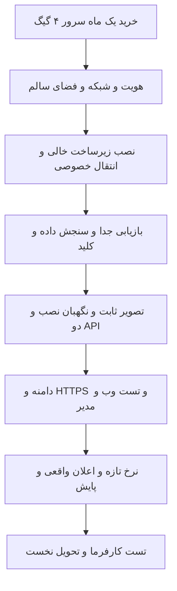

# سرور کم‌خرج و انتقال نرخ‌بان

وضع تازه۱۰نوامبر: خرید تازه فعلاً انجام نشده؛ [میزبان مشترک بررسی و کش‌های بی‌مصرفش پاک شد](shared-host-maintenance-2026-11-10-fa.md). [اصلاح نرخ حجیم و آزمون فشار محلی](pricing-history-performance-2026-11-10-fa.md) اکنون پاس؛منابع میزبان هنوز شرط امن را ندارد و نصب انجام نشد. در طرح تازه،پایگاه۱٫۵۰هسته و هرAPI۰٫۲۵هسته؛جمع این سه۲هسته و سقف رم کامل۲٫۵GiBاست. بستهٔ خصوصی تازه با کد اصلاح‌شده و هش بکاپ ساخته و وارسی شد؛این بسته هنوزlive_ready:falseدارد. قیمت‌های زیر،شاهد تاریخ‌دار۹نوامبرند.

مرور قیمت:۹نوامبر۲۰۲۶. هنوز میزبان تازه نداریم؛ خرید و نصب راه دور انجام نشده. بودجه برای **فقط نرخ‌بان** است؛ بکاپ پروژه‌های دیگر محفوظ می‌ماند.

## چه بخرم؟

حداقل پیشنهادی برای شروع: **۲هسته،۴گیگ رم،۴۰گیگ SSD/NVMe،Ubuntu24.04LTS با معماریx86_64/amd64،یکIPv4 عمومی و دسترسیroot یاsudo**. حداقل۱ترابایت ترافیک، خروج عادی اینترنت و امکانDocker لازم است. آلمان یا اروپا برای راه خدمات اعلان ترجیح دارد؛ محل اروپا به‌تنهایی اثبات باز بودن راه نیست. Windows،cPanel و گواهی پولی لازم نیست. فعلاً فقط یک ماه بخر؛ پیش از خرید بلندمدت تست شبکه و تحویل پاس شود.

| گزینه | قیمت درج‌شده | مشخصات و حد ادعا |
| --- | --- | --- |
| [هاست‌سازان،CX22-Hetzner](https://my.hostsazan.com/store/germany-cloud-vps) |۴۲۱٬۰۰۰تومان در ماه |۲هسته،۴گیگ،۴۰گیگNVMe،۲۰ترابایت؛ تحویل درج‌شده یک روز. کمترین قیمت تأییدشده در این بررسی، نه تضمین موجودی |
| [پرشین میزبان،PLN1آلمان](https://www.persianmizban.com/vps/germany) |۵۹۰٬۰۰۰تومان درج‌شده |۲هسته،۴گیگ،۴۰گیگ،۲۰ترابایت؛ جایگزین در صورت نبود پلن اول. دوره و مبلغ نهایی در پیش‌فاکتور تأیید شود |

**پیش از پرداخت:** از میزبان بخواه همان مشخصات،IPv4،خروج اینترنت،موجودی و مبلغ نهایی با مالیات و هزینه راه‌اندازی را تأیید کند. قیمت فهرست، مبلغ نهایی پرداخت نیست؛ این هزینه‌های اضافه از صفحه‌ها روشن نشدند. نام قدیمیCX22به‌تنهایی معیار خرید نیست. راه‌اندازی فوری وعده داده نشده؛ پلن اول تحویل یک‌روزه نوشته است. ۴گیگ شروع کم‌خرج معقول است؛ تضمین بار یا شمار کاربر نیست. ۲گیگ برای پایگاه،صف و دوAPI حاشیه امن کافی نمی‌دهد.

## چه آماده شده؟

- `docker-compose.budget.yaml`: لایهٔ مصرف کمتر روی فایل اصلی؛ دوAPI حفظ می‌شوند. پایگاه۷۶۸مگ،صف۲۵۶مگ،هرAPI۵۱۲مگ،وب و پنل هرکدام۹۶مگ و لبه۱۲۸مگ. با backup و feed سقف جمع خدمت‌های معمول حدود۲٫۵گیگ است؛ زمان migrateحدود۳۸۴مگ اضافه. مانیتورینگ سنگین و collectorاختیاری روشن نشوند. این سقف‌ها تست بار سرور نیستند.
- `scripts/prepare_host_move.py`: کپی خصوصی با هش،منبع ثابتGit و تنظیم معتبر snapshot؛ منبع اصلی بکاپ را تغییر نمی‌دهد. فقط بعد از commitتمیز بسته می‌سازد؛ پوشه موجود را بازنویسی نمی‌کند.
- `scripts/rehearse_host_restore.py`: بازیابی snapshotثابت روی ظرف تازه،بدون شبکه و درگاه،با سقف۷۶۸مگ. اصل dumpو پایگاه محلی سایت دست‌نخورده‌اند؛ تست موفق فقط ظرف و حجم خودش را پاک می‌کند. شکست فایل خصوصی دارد و تکرار خودکار ندارد.
- `scripts/new-host-preflight.sh`: سنجش فقط‌خواندنی سخت‌افزار،فضا،سیستم،ساعت و درگاه‌ها؛ نصب یا تغییر شبکه نمی‌کند. Dockerو شبکه و برنامه هنوز گیت جدا دارند.

بستهٔ جاری بیرونGitدر `D:\Projects\Nerkhbaan\delivery\host-move-20261110-pricing-fixed` با منبع `1689400152ac9d3884cb979778e67cf46c200898` و۹فایل هم‌هش است؛کد برنامه همان `9fa618559acab75ab6b808d214bdd811c22659ec` آزموده است. بستهٔ۹نوامبر تاریخی و محفوظ ماند. فایل‌های آن خصوصی‌اند؛ در Git،گفتگو یا میزبان عمومی قرار نگیرند. `KIT_MANIFEST.json` هش هر فایل و commitمنبع را ثبت می‌کند؛ `live_ready:false` تا پذیرش زنده پابرجاست.

شاهد۹نوامبر:هفت تست حفاظت بسته،بررسی نام‌ها و نحو،یکسانی نسخه و ترکیبComposeبا پروفایلedge/backupپاس. تست نخست بازیابی،آمادگی زودهنگام پایگاه موقت نصب را دید و متوقف شد؛ رسید شکست محفوظ ماند. ابزار اصلاح شد تا آماده‌شدنTCPپایگاه نهایی را ببیند. بازیابی تازه در۱۱:۱۵تا۱۱:۱۶UTCبا سقف۷۶۸مگ پاس:۵۵جدول،۱۰مهاجرت،۳۸۹۵۵۵نرخcanonical،۶۳۷۵۹۵نرخproviderو۲۶۶۶۲نرخlegacyبا snapshotبرابر شد؛ کارهای نگهداری قدیم خاموش ماندند. ظرف و حجم آزمون خودش پاک شدند. رسید `D:\Projects\Nerkhbaan\delivery\host-move-check-20261109-r2\restore-result.json` مربوط به منبع ابزار `dd921df66919639a494a1c0fa3a87e0bed6d09f1` است؛ بستهٔ تاریخیr3فقط سند تازه داشت؛ بستهٔ جاریfinalاصلاح خروج پس از تغییر رمز را هم دارد. ابزار بازیابی و dumpهمان نسخهٔ آزموده‌اند. امتیاز آماده‌سازی محلی پس از اصلاح۹از۱۰؛ پذیرش زنده همچنان باز است.

## فرمان‌های آمادهٔ محلی

از ریشهٔ منبع،پس از commitتمیز:

```powershell
python scripts/prepare_host_move.py pack --backup D:\Projects\Nerkhbaan\delivery\private-backups\rescue-20261031 --output D:\Projects\Nerkhbaan\delivery\host-move-20261109-final
python scripts/prepare_host_move.py verify --output D:\Projects\Nerkhbaan\delivery\host-move-20261109-final
python scripts/rehearse_host_restore.py --wsl --kit D:\Projects\Nerkhbaan\delivery\host-move-20261109-final --output D:\Projects\Nerkhbaan\delivery\host-move-check-20261109-r3
```

خروجی موجود باشد،اول رسیدش خوانده شود؛ برای اجرای تازه نام یکتا لازم است. تصویر بازیابی باید همان شناسهٔ ثابت داخل ابزار باشد؛ نبود تصویر مجوز جایگزینی کور نیست. بازبینی۷۶۸مگ فقط بازیابی و شمارش را ثابت می‌کند،نه پایداری کل برنامه زیر بار.

## پس از خرید،چه بدهی؟

نشانیIPv4،پورتSSH،نام کاربر و داشتنroot/sudo را بگو. راه دسترسی را در فایل خصوصی تازه قرار می‌دهیم؛ رمز و کلید در گفتگو نفرست. اثرانگشت کلیدSSHرا از کنسول رسمی میزبان می‌گیریم و در known_hostsجدا قفل می‌کنیم؛ پذیرش کورکلید ممنوع. دسترسیDNSدامنه هم لازم است؛ تغییر تا مقصد سالم نباشد انجام نمی‌شود. ابزارSSHقدیمی نشانی سرور پیشین را دارد؛ برای مقصد تازه مصرف نشود.

## نوبت نصب و انتقال

1. هویتSSHو سخت‌افزار،فضا،خدمت‌های حاضر،ساعت و خروجDNS/TLSبه منبع قیمت و مسیرApple/FCM/Mozilla سنجیده شود. پورت۸۰/۴۴۳و مدیریت بررسی شوند؛ دیوار بی‌بررسی تغییر نکند.
2. روی میزبان خالی،DockerEngineوComposeاز مخزن رسمی،پوشه خصوصی،حجم پایدار و بکاپ بیرون میزبان آماده شود. این نصب هنوز اجرا نشده؛ فرمان نسخهٔ روز در همان نوبت با سند رسمی سنجیده شود. فایل فعلی نصب برنامه برای ساخت زیرساخت خالی نیست؛ خط مبنای قدیمی۲۲ظرف به میزبان تازه نسبت داده نشود.
3. بسته از راهSSHقفل‌شده منتقل و دوباره هش سنجیده شود. dumpروی حجم جدا بازیابی شود؛ نقش و مالکیت برنامه بررسی شود. فایل نقش‌های قدیمی کامل اجرا نشود؛ مجوزsuperuserو رمز قدیم کور وارد نشود. ابزار rehearsalپایگاه تمرینی می‌سازد؛ ابزار نصب مستقیم پایگاه مشتری نیست.
4. تنظیم فعال قدیم در `configuration-3.private.env` بازبینی شود؛ نشانی قدیم،شبکه،TLSو دامنه برای مقصد جدید اصلاح شوند. کلید معتبررمزگذاری،JWTوVAPIDحفظ شود؛ کلید تازه کور ساخته نشود. Redisتازه و خالی شروع شود؛ صف قدیمی و اعلان‌های مانده بازپخش نشوند. فایل‌هایSSH،دیوار و tarهمه پروژه‌ها روی میزبان تازه باز نشوند.
5. تصویرهای ثابت از commitنهایی باCIو اسکن تازه ساخته شوند؛ روی میزبان۴گیگ buildنکنیم. نگهبان فقط یک `COMPOSE_OVERRIDE_FILE` می‌خواند:تنظیم بودجه باید پیش از گرفتن شواهد در همان overrideخصوصیِ تصویر ثابت ادغام و نتیجهٔComposeدوباره سنجیده شود؛ فایل سوم خودکار خوانده نمی‌شود. خط مبنای میزبان تازه و گیت محیط/حق مصرف/مهاجرت حاضر شوند؛ سپس نگهبان رسمی `scripts/deploy-nerkhbaan-prod.sh` و `scripts/deploy_application.py` مصرف شود. هیچ گیت و دوAPIحذف نشوند.
6. نخست با دامنه به مقصد سالم و HTTPSمعتبر تست:ثبت‌نام،ورود،مدیر،خروج،نشست لغوشده،جدایی حساب،نرخ تازه و هشدار. ۲۴ساعت پایش نرخ/صف و بکاپ بیرون میزبان لازم است. سپس دریافت و کلیک اعلان رویiPhoneاز صفحه اصلی،Androidو رایانه و پیام تلگرام/بله؛ رسید واقعی هر مسیر ثبت شود.



سرور و دسترسیDNSهنوز حاضر نیستند؛ نصب زنده،تست بار،راه شبکه،رسید دستگاه و تحویل نخست ادعا نشده‌اند. پیامک و تماس نیز خدمت واقعی ندارند. امضای ویندوز شرط تحویل وب نیست. جزئیات شرط‌های باقی‌مانده در [نقشهٔ تحویل](project-completion-roadmap-fa.md) بماند.
