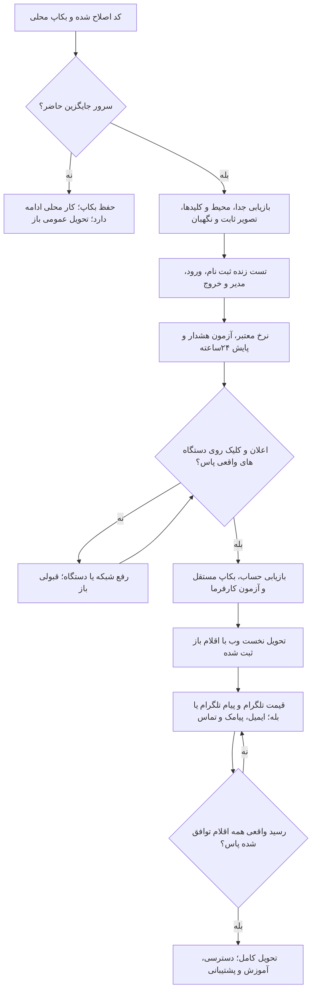
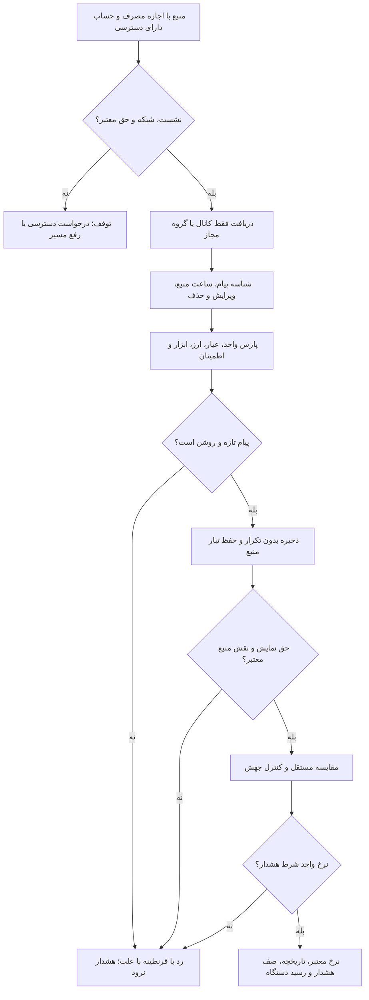

# نقشهٔ تحویل نرخ‌بان — وب و وب‌اپ

مرور:۳۱اکتبر۲۰۲۶. تحویل کامل هنوز باز است. نسخهٔ منتشرشده۲.۸.۱۹است؛ اصلاح‌های تازهٔ ورود و اعلان در منبع کاری‌اند و نصب زندهٔ آن‌ها تأیید نشده. سرور قبلی طبق گفتهٔ مالک فقط تا پایان امروز تمدید شده؛ سرور جایگزین هنوز حاضر نیست. [شاهد نجات داده](server-rescue-2026-10-31-fa.md)، [راه بازیابی](server-recovery-guide-fa.md).

شاهد محلی این دور:۱۳۱تست رابط،۴۹تست مرورگر و ساخت وب پاس. [دامنهٔ تست و شکست‌های حفظ‌شده](web-handoff-readiness-2026-10-31.md). دریافت واقعی دستگاه و استقرار تازه همچنان بازند.

## الان چه چیز داریم

کارِ بدون سرور و کلید: [مرور محلی وب](local-web-preview-fa.md) با پایگاه جدا و پایدار، ثبت‌نام، ورود، هشدار، نمودار نمونه و پیام داخل سایت حاضر است. این مسیر، تحویل عمومی یا دریافت واقعی اعلان نیست. اجرای محلی به داده و بکاپ نجات‌یافته دست نمی‌زند.

| بخش | وضع کد / شاهد | حدِ همین شاهد |
| --- | --- | --- |
| ثبت‌نام و ورود | تداخل ورود سریع با وارسی نشست اصلاح شد؛ ارسال زودهنگام بسته و وضع انتظار روشن است | اصلاح محلی؛ نصب تازه و آزمون زنده هنوز لازم |
| اعلان وب | خواندن ناموفق اشتراک هنگام شروع برنامه مهار می‌شود؛ تلاش بعدی می‌تواند ثبت را کامل کند | پشتیبانی نرم‌افزار، رسید دستگاه نیست؛ شبکه و iPhone واقعی بازند |
| هشدار | ساخت/ویرایش، قیمت مبنا، شدت، انتخاب کانال، صف و جلوگیری از تکرار در کد حاضرند | رسید واقعیِ «نرخ معتبر تا دستگاه» هنوز شرط است |
| نرخ و تاریخچه | هشت مسیر بومی و سه مرجع با نام/سن جدا، ذخیرهٔ پایدار و شرط تازگی حاضرند | نمونه‌های نرخ قدیمی، شاهد تازگی امروز یا پایش۲۴ساعت نیستند |
| پنل مدیر | کاربر، منبع، حق مصرف، تحویل و اتصال کاوه‌نگار/Asterisk ARI حاضرند | خدمت واقعی پیامک/تماس هنوز حاضر نیست |
| قیمت تلگرام | کد کانال، گروه عادی/سوپرگروه، پارس، ویرایش، حذف و بازیابی محدود حاضر است | حساب و منبع مجاز نیست؛ collector خاموش؛ دریافت واقعی قبول نشده |
| نگهداری | بکاپ تازهٔ۳۱اکتبر روی رایانه بازیابی شد؛ دو کپی هم‌هش از داده و تنظیم حاضر است | هر دو کپی روی همین رایانه؛ مقصد مستقل و زمان‌بندی هنوز لازم |

## چه وقت تحویل نخست وب ممکن است؟

همهٔ ردیف‌های زیر باید روی **نسخهٔ نصب‌شدهٔ نهایی** پاس شوند؛ صرف ساخت محلی یا HTTP۲۰۰ کافی نیست. تا سرور جایگزین و رسید واقعی اعلان نباشد، وب برای استفادهٔ کارفرما تحویل‌شده نیست.

| اولویت | کار لازم | مجری / نیاز مالک | شرط روشنِ پایان |
| --- | --- | --- | --- |
| ۱ | میزبان پایدار، دامنه و HTTPS | مالک سرور جایگزین بدهد؛ مجری بازیابی و زیرساخت را ببندد | پایگاه و کلیدها سالم، نسخه/تصویر دقیق، نگهبان و دو API پاس؛ دامنه به میزبان سالم برسد |
| ۲ | نصب اصلاح‌های ورود و اعلان | مجری؛ حساب فقط‌آزمون | ثبت‌نام، ورود با نام/ایمیل در عرض باریک و رایانه، بازخوانی نشست، خروج، رد نشست لغوشده، دسترسی مدیر و جدایی حساب‌ها پاس |
| ۳ | نرخ معتبر و هشدار درست | مجری؛ منابع دارای اجازه | واحد/عیار/ارز روشن؛ نرخ کهنه، ناموجود یا بی‌اجازه هشدار نسازد؛ ۲۴ساعت پایش، قطع/وصل و cooldown ثبت شود |
| ۴ | دریافت واقعی اعلان وب | مجری و مالک دستگاه؛ iPhone، Android، رایانه | iPhone از نشان صفحهٔ اصلی؛ در پس‌زمینه یا صفحهٔ قفل پیام برسد، کلیک به هشدار درست برود؛ خروج، وابستگی دستگاه را ببندد. هر دستگاه رسید جدا |
| ۵ | بازیابی حساب و نگهداری | مالک خدمت ایمیل و مقصد مستقل بدهد؛ مجری وصل و تست کند | بازیابی رمز با رسید واقعی صندوق کار کند؛ بکاپ زمان‌بندی‌شده خارج از میزبان با بازیابی جدا و هشدار شکست پاس شود |
| ۶ | آزمون خود کارفرما و راهنمای کوتاه | کارفرما و مجری | کارفرما حساب بسازد، قیمت/سن منبع را بفهمد، هشدار بسازد/ویرایش/خاموش کند، پیام بگیرد و خارج شود؛ ایرادهای همان آزمون بسته و پذیرش ثبت شود |

**دامنه تحویل نخست:** وب و وب‌اپِ قابل استفاده با اعلان واقعی. کارهای خواسته‌شدهٔ زیر حذف نشده‌اند؛ در صورت تحویل مرحله‌ای باید با نام و وضعِ باز در صورت‌جلسه بیایند. اگر یکی از آن‌ها شرط همان تحویل کارفرماست، پیش از همان تحویل باید پاس شود.

## چه چیز تا تحویل کامل مانده؟

| کار باز | چه چیز حاضر است | چه چیز هنوز لازم است |
| --- | --- | --- |
| خواندن قیمت از کانال و گروه تلگرام | کد و تست دریافت/پارس/حق/تازگی | حساب خواننده، یک کانال و یک گروه مجاز، نمونهٔ پیام و حق مصرف؛ دریافت، ویرایش، حذف، قطع/وصل و «پیام تا هشدار» واقعی |
| هشدار در تلگرام یا بله | مسیر اتصال ربات تلگرام هست؛ مسیر بله در مرور قبلی یافت نشد | ربات و مقصد مجاز؛ دریافت واقعی تلگرام. اگر بله انتخاب شود، آداپتر و اتصال/صف/تست بله هم ساخته و سنجیده شود |
| ایمیل هشدار | مسیر نرم‌افزار هست | خدمت ارسال، فرستنده و تنظیم دامنه؛ رسید واقعی صندوق. بازیابی رمز نیز به ایمیلِ کارا نیاز دارد |
| پیامک | پنل و آداپتر کاوه‌نگار هست | حساب، کلید، خط فرستنده، اعتبار و شمارهٔ دارای رضایت؛ رسید واقعی پیامک |
| تماس در حالت خاص | پنل Asterisk ARI و سیاست تماس بحرانی هست | مرکز تماس، ARI، ترانک خروجی و مقصد مجاز؛ تماس طبق سیاست، پاسخ واقعی و ثبت نتیجه |
| تحویل و پشتیبانی | سند نسخه و راه بازیابی هست | انتقال دسترسی خصوصی، مسئول پایش، برنامه بکاپ، آموزش و بستن اقلام توافق‌شده با کارفرما |
| ویندوز، مسیر جدا | ساخت بسته هست؛ SignPath رایگان رد شده و حساب Store نیست | ناشر معتبر و تست نصب/ارتقا/حذف/اعلان. این مسیر، شرط تحویل وب نیست |

امضای ویندوز، نبود حساب پیامک یا نبود PBX نباید به‌جای اولویت وب بنشیند؛ با این حال قابلیتِ بدون خدمت یا رسید، کامل نام نگیرد. بازار ممکن است نرخ تازه ندهد؛ کهنگی و شکاف تاریخچه باید آشکار بماند. سه مرجع طلای۲۴، BTC/USD و USDT/USD، نرخ مستقیمِ بازار نیستند و شرط هشدارشان جداست.

## تلگرام: کد۲.۸.۱۹؛ پذیرش واقعی باز

| کد | کارِ حاضر | حدِ فعلی |
| --- | --- | --- |
| `apps/telegram_worker/app/worker.py` | فهرست مجاز از پایگاه، پیام تازه و ویرایش، جلوگیری از تکرار، ذخیرهٔ نرخ و نتیجهٔ پارس | گروه عادی و سوپرگروه در کد جدا پشتیبانی؛ حذف، بازیابی محدود و پیوند حساب افزوده شد؛ آزمون واقعی باز است |
| `apps/telegram_worker/app/parser.py` | پارس سخت، رقم فارسی/عربی، واحد، عیار، دامنه و اطمینان | قالب واقعی هر منبع باید با نمونهٔ مجاز سنجیده شود؛ یازده قالب صریح حاضر؛ متن دلخواه، عکس و صدا تضمین نیست |
| `apps/telegram_worker/app/source_rights.py` | حقِ تاریخ‌دار برای `telegram:<source_id>`؛ نبود حق یعنی نخواندن | حقِ کانال از عمومی‌بودن یا عضویت نتیجه نمی‌شود؛ مدرک و دامنهٔ مجاز لازم |
| `apps/api/app/admin/routers/providers.py` | ثبت/ویرایش منبع و پیش‌نمایش پارس با مجوز مدیر | ثبت منبع، به‌تنهایی نشست و اتصال زنده نمی‌سازد |
| `apps/api/app/pricing/telegram.py` | خواندن نرخ ذخیره‌شده با شرط تازگی، حق و نقش | مصرف قیمت فقط نقش `verifier` یا `fallback` می‌پذیرد؛ منبع اصلی خودکار نیست |
| `docker-compose.prod.yaml` | سرویس با پروفایل `telegram` | overlay اختیاری، فایل حق و پیوند حساب دارد؛ تصویر ثابت و اتصال واقعی هنوز پذیرش جدا خواهند |

### شرط قبولی تلگرام

1. یک کانال و یک گروه مورد تأیید مالک مشخص؛ شناسهٔ عددی درست، حق مصرف و حساب مجاز ثبت شود. گروه عادی، سوپرگروه و کانال با هم یکی شمرده نشوند.
2. پیام واقعی، ویرایش و تکرار با شناسه و ساعت درست ذخیره شوند. پیام مبهم، کهنه، آینده، واحد غلط، عیار نامعلوم و منبع ناشناس وارد هشدار نشوند.
3. برای حذف پیام، قطع/وصل، محدودیت درخواست، ابطال نشست، توقف خدمت و شروع دوباره سیاست و تست پایدار تکمیل شود. برای عقب‌مانده فقط تاریخچهٔ دارای اجازه جمع شود؛ هشدار قدیمی دوباره نرود.
4. سیاست مقایسه/جایگزین، اختلاف با منبع مستقل و لغو حق روی worker و API پاس شوند. نقش اصلی، صرف ثبت در پنل ایجاد نشود.
5. یک چرخهٔ واقعی «پیام → نرخ ذخیره → تاریخچه → هشدار → رسید» با شاهد بدون راز پاس شود. ۲۴ساعت پایش، سن منبع، تأخیر، قطع و نرخ ردها ثبت شود. پیام آزمون فقط در فضای تحت اختیار و با رضایت ارسال شود.
6. تصویر ثابت و اسکن، تست پایگاه واقعی، نگهبان استقرار، دو API و سرویس‌های محافظت‌شده پاس شوند. سپس کانال‌های بیشتر با همین دروازه افزوده شوند.

## دقیق از مالک چه لازم است؟

| بخش | داده یا کار لازم | راه امن |
| --- | --- | --- |
| میزبان | سرور جایگزین، نشانی، پورت SSH، کاربر و هویت میزبان؛ دسترسی دامنه | رمز و کلید فقط راه خصوصی؛ در گفتگو نیاید |
| دستگاه | iPhone اصلی کارفرما، Android و رایانه با رضایت اعلان | ورود و اجازه را مالک دستگاه بدهد؛ شاهد زمان دریافت و کلیک ثبت شود |
| قیمت تلگرام | `TELEGRAM_API_ID`، `TELEGRAM_API_HASH`، `TELEGRAM_SESSION_STRING`؛ حساب و منابع مجاز | `D:\Projects\Nerkhbaan\repo\.local-keys\telegram-ingestion.private.env`؛ کد ورود و نشست در گفتگو نیاید |
| منبع تلگرام | شناسهٔ دقیق کانال/گروه، ابزارها، قالب و اجازهٔ دریافت/ذخیره/نمایش/تاریخچه | [راهنمای اتصال](telegram-ingestion-guide-fa.md)؛ منبع خصوصی کانالیِ بی‌نام ممکن است `TELEGRAM_PEER_ACCESS_HASHES` همان حساب را هم بخواهد |
| پیام تلگرام | `TELEGRAM_BOT_TOKEN` و مقصد متصل به حساب | محیط خصوصی و تأیید خود کاربر؛ توکن ربات جای نشست خواندن قیمت نیست |
| ایمیل | `SMTP_HOST`، `SMTP_FROM`، پورت/TLS و در صورت نیاز `SMTP_USERNAME` و `SMTP_PASSWORD`؛ مقصد آزمون | `D:\Projects\Nerkhbaan\repo\.local-keys\notification-delivery.private.env`؛ رسید صندوق لازم |
| پیامک | کلید کاوه‌نگار، خط، اعتبار و شمارهٔ مجاز | در پنل مدیر؛ [راهنمای اتصال](admin-guide.md#راهنمای-اتصال-پیامک-و-تماس) |
| تماس | ARI `endpoint`، `username` و `password`، ترانک و مسیر تماس | در پنل مدیر؛ راهنما و تست پاسخ واقعی جدا |
| بکاپ مستقل | دیسک جدا یا مقصد خصوصی بیرون از این رایانه و سرور | کپی با هش برابر، برنامهٔ دوره‌ای و بازیابی آزمایشی |

کلیدهای معتبر VAPID و رمزگذاری موجود، داخل بکاپ خصوصی حفظ شده‌اند؛ بی‌علت کلید تازه ساخته نشود. فایل خالی و مقدار نمونه، وجود خدمت نیست. مالک قبلاً گفته حساب/منابع تلگرام، خدمت پیامک/PBX و دستگاه‌های تست فعلاً حاضر نیستند؛ نبود آن‌ها با تست بدل پوشانده نشود.

## چک نهاییِ امضا توسط کارفرما

- [ ] دامنه، HTTPS و نسخهٔ دقیق روی میزبان پایدار ثبت شد.
- [ ] کاربر و مدیر با حساب جدا وارد و خارج شدند؛ نقش و نشست آزموده شد.
- [ ] نرخ معتبر، سن/واحد و نبود نرخ فهمیده شد؛ هشدار روی نرخ نامعتبر نرفت.
- [ ] ساخت، ویرایش، توقف، حذف و جلوگیری از پیام تکراری سنجیده شد.
- [ ] اعلان و کلیک واقعی روی دستگاه‌های توافق‌شده رسید دارد؛ iPhone در اولویت است.
- [ ] بازیابی رمز و بکاپ مستقل با تست واقعی پاس شد.
- [ ] راهنمای استفاده، دسترسی خصوصی و مسئول پشتیبانی تحویل شد.
- [ ] قابلیت‌های باز با نام روشن ثبت شد؛ اقلام لازمِ قرارداد هنوز باز نماند.

[راهنمای تحویل نخست](web-initial-delivery-fa.md) · [فهرست سندها](documentation-index-fa.md). رسید و CI هر نسخه، فقط همان منبع و زمان را پوشش می‌دهد؛ تست محلی، تصویر قدیم یا پاسخ۲۰۰، قبولی کامل پروژه نیست.
