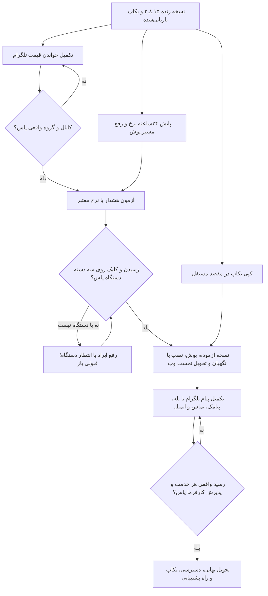
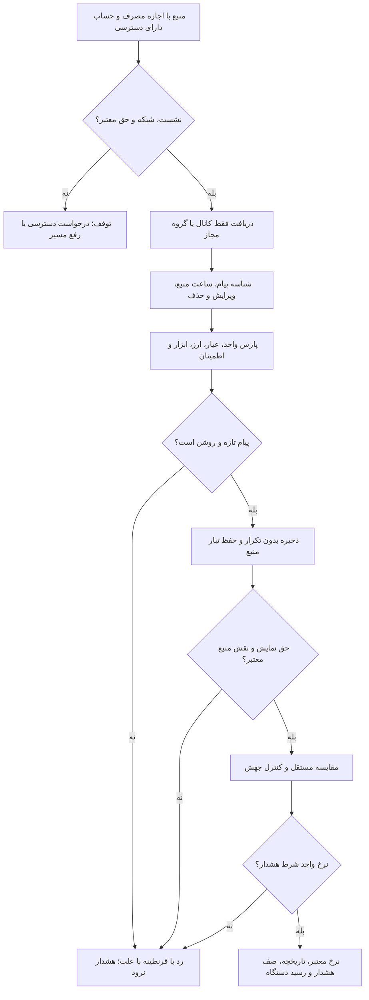

# نقشهٔ پایان پروژه و تحویل — ۲.۸.۱۷

تاریخ مرور: ۲۸ اکتبر ۲۰۲۶. نسخهٔ سند و منبع: **۲.۸.۱۷**. آخرین نصبِ پذیرفته‌شده: **۲.۸.۱۵**. این نسخه، پایان کل پروژه یا نصب تازه نیست.

## مقصد تحویل

کارفرما از وب‌سایت و وب‌اپ استفاده کند؛ نرخ معتبر ببیند، هشدار بسازد و پیام را روی دستگاه خود بگیرد. **خواندن قیمت از کانال و گروه تلگرام، خواست اصلی و کارِ باز است.** فرستادن پیام هشدار در تلگرام، کار جداست. امضای نصب ویندوز، سد تحویل وب نیست.

## چه چیز داریم؛ چه چیز نداریم

| بخش | شاهد موجود | کارِ باز برای قبولی |
| --- | --- | --- |
| سایت، ثبت‌نام، ورود و خروج | نصب ۲.۸.۱۵؛ ۱۸ سنجش واقعی حساب و دارایی وب/پنل پاس | آزمون کارفرما و رفع ایرادِ همان آزمون |
| قیمت و تاریخچه | هشت مسیر بومی تازه در نمونهٔ نصب؛ سه مرجع با برچسب جدا؛ ذخیرهٔ واقعی | پایش پیوستهٔ ۲۴ساعته، قطع/وصل منبع و هشدارِ مبتنی بر نرخ معتبر |
| قیمت از تلگرام | کد کانال/گروه، حذف/ویرایش، بازیابی محدود، پارس و کشِ امن در نامزد۲.۸.۱۷؛ کار واقعی ثابت نیست | منبع مجاز، حساب، نشست، راه شبکه، تکمیل گروه/بازیابی و آزمون واقعی |
| پوش وب | کد، صف و اشتراک هست | مسیر Apple و رسیدن/کلیک روی iPhone، Android و رایانه؛ دستگاه فعلاً حاضر نیست |
| پیام هشدار تلگرام | کد ربات و اتصال مقصد هست | رباتِ تنظیم‌شده، مقصدِ صاحب حساب، رضایت، رسید و کلیک واقعی |
| پیام بله | در مرور کد، مسیرِ محصول یافت نشد | اگر جایگزین تلگرام شد: آداپتر، اتصال مقصد، صف، تست و رسید واقعی |
| پیامک و تماس | پنل کاوه‌نگار و Asterisk ARI، رمزگذاری و سیاست تماس هست | خدمت، خط/اعتبار یا ترانک، مقصد مجاز، رسید پیامک و پاسخ تماس؛ خدمت فعلاً حاضر نیست |
| ایمیل | مسیر نرم‌افزار هست؛ ایمیل دوباره در دامنهٔ خواست است | خدمت ارسال، فرستنده، تنظیم دامنه و رسید صندوق؛ خدمت فعلاً حاضر نیست |
| حفظ داده | dump کامل، بازیابی واقعی و دو کپی هم‌هش روی یک رایانه | مقصد مستقل از این رایانه، زمان‌بندی، هشدار شکست و تمرین بازیابی |
| ویندوز | ساخت و سنجش‌های محلیِ ثبت‌شده | امضای ناشر و نصب/اعلان واقعی؛ درخواست رایگان SignPath رد شده، حساب Store نیست |

نمونهٔ سالم نرخ، قولِ همیشه‌تازه نیست. مرجع طلای۲۴، BTC/USD و USDT/USD با نرخ مستقیم یکی نیست؛ مرجع‌ها وارد هشدار عادی نشوند. شکافِ تاریخچه با عدد ساختگی پر نشود. [شاهد نصب و بکاپ](pricing-release-2.8.15-fa.md).

## ترتیب کار

| ترتیب | کار | صاحب اقدام | شرط پایان |
| --- | --- | --- | --- |
| ۱، فوری | یک نسخهٔ کامل بکاپ به مقصد مستقل برسد | مالک مقصد بدهد؛ مجری کپی و بازیابی بسنجد | هش برابر، دسترسی محدود، بازیابی جدا، مسیر و زمان ثبت |
| ۲، اولویت محصول | قیمتِ تلگرام، نخست یک کانال و یک گروه مجاز | مالک دسترسی/منبع بدهد؛ مجری پیاده‌سازی و تست کند | همهٔ دروازه‌های تلگرامِ پایین پاس؛ سپس افزایش منبع |
| ۳، کنار گام۲ | پایش نرخ و مسیر پوش؛ آماده‌سازی آزمون دستگاه | مجری؛ مالک دستگاه حاضر کند | ۲۴ساعت شاهد نرخ و تحویل/کلیک واقعی روی سه دسته دستگاه |
| ۴ | تحویل نخست وب و وب‌اپ به کارفرما | کارفرما و مجری | ساخت هشدار، دریافت، کلیک، ورود و خروج، قطع/وصل و راهنمای استفاده پاس |
| ۵ | تکمیل پیام تلگرام یا بله؛ سپس پیامک، تماس و ایمیل | مالک خدمت بدهد؛ مجری متصل کند | برای هر مسیر، رسید واقعی جدا؛ فعال‌سازی فقط پس از قبولی همان مسیر |
| ۶ | تحویل نهایی، انتقال دسترسی و پشتیبانی | مالک و مجری | اقلام قرارداد، سند نسخه، بکاپ، پایش، آموزش و پذیرش کتبی بسته شوند |
| جدا | نصب امضاشدهٔ ویندوز | مالک مسیر امضا فراهم کند | ناشر معتبر، نصب/ارتقا/حذف و اعلان واقعی؛ تحویل وب منتظرش نماند |

شماره‌های قدیمیِ «گام۳/۴/۵» در گزارش‌ها سابقه‌اند. جدول بالا، صفِ فعلی تحویل است. زمان پایان تا روشن‌شدن منبع، دسترسی و دستگاه قابل قول نیست.

## تلگرام: کد نامزد۲.۸.۱۷؛ پذیرش واقعی باز

| کد | کارِ حاضر | حدِ فعلی |
| --- | --- | --- |
| `apps/telegram_worker/app/worker.py` | فهرست مجاز از پایگاه، پیام تازه و ویرایش، جلوگیری از تکرار، ذخیرهٔ نرخ و نتیجهٔ پارس | گروه عادی و سوپرگروه در کد جدا پشتیبانی؛ حذف، بازیابی محدود و پیوند حساب افزوده شد؛ آزمون واقعی باز است |
| `apps/telegram_worker/app/parser.py` | پارس سخت، رقم فارسی/عربی، واحد، عیار، دامنه و اطمینان | قالب واقعی هر منبع باید با نمونهٔ مجاز سنجیده شود؛ یازده قالب صریح حاضر؛ متن دلخواه، عکس و صدا تضمین نیست |
| `apps/telegram_worker/app/source_rights.py` | حقِ تاریخ‌دار برای `telegram:<source_id>`؛ نبود حق یعنی نخواندن | حقِ کانال از عمومی‌بودن یا عضویت نتیجه نمی‌شود؛ مدرک و دامنهٔ مجاز لازم |
| `apps/api/app/admin/routers/providers.py` | ثبت/ویرایش منبع و پیش‌نمایش پارس با مجوز مدیر | ثبت منبع، به‌تنهایی نشست و اتصال زنده نمی‌سازد |
| `apps/api/app/pricing/telegram.py` | خواندن نرخ ذخیره‌شده با شرط تازگی، حق و نقش | مصرف قیمت فقط نقش `verifier` یا `fallback` می‌پذیرد؛ منبع اصلی خودکار نیست |
| `docker-compose.prod.yaml` | سرویس با پروفایل `telegram` | overlay اختیاری، فایل حق و پیوند حساب دارد؛ تصویر ثابت و اتصال واقعی هنوز پذیرش جدا خواهند |

### شرط قبولی تلگرام

1. یک کانال و یک گروه مورد تأیید مالک مشخص؛ شناسهٔ عددی درست، حق مصرف و حساب مجاز ثبت شود. گروه عادی، سوپرگروه و کانال با هم یکی شمرده نشوند.
2. پیام واقعی، ویرایش و تکرار با شناسه و ساعت درست ذخیره شوند. پیام مبهم، کهنه، آینده، واحد غلط، عیار نامعلوم و منبع ناشناس وارد هشدار نشوند.
3. برای حذف پیام، قطع/وصل، محدودیت درخواست، ابطال نشست، توقف خدمت و شروع دوباره سیاست و تست پایدار تکمیل شود. برای عقب‌مانده فقط تاریخچهٔ دارای اجازه جمع شود؛ هشدار قدیمی دوباره نرود.
4. سیاست مقایسه/جایگزین، اختلاف با منبع مستقل و لغو حق روی worker و API پاس شوند. نقش اصلی، صرف ثبت در پنل ایجاد نشود.
5. یک چرخهٔ واقعی «پیام → نرخ ذخیره → تاریخچه → هشدار → رسید» با شاهد بدون راز پاس شود. ۲۴ساعت پایش، سن منبع، تأخیر، قطع و نرخ ردها ثبت شود. پیام آزمون فقط در فضای تحت اختیار و با رضایت ارسال شود.
6. تصویر ثابت و اسکن، تست پایگاه واقعی، نگهبان استقرار، دو API و سرویس‌های محافظت‌شده پاس شوند. سپس کانال‌های بیشتر با همین دروازه افزوده شوند.

## دسترسی لازم از مالک

| بخش | چه چیز لازم است | محل امن / کار مالک |
| --- | --- | --- |
| خواندن قیمت تلگرام | `TELEGRAM_API_ID`، `TELEGRAM_API_HASH`، `TELEGRAM_SESSION_STRING`؛ حسابِ دارای دسترسی؛ فهرست منابع و اجازهٔ مصرف | فایل خالیِ ساخته‌شده، هنوز بی‌کلید: `D:\Projects\Nerkhbaan\repo\.local-keys\telegram-ingestion.private.env`. کد ورود و رمز دوم فقط در ورود رسمیِ خود مالک؛ نشست در گفتگو یا Git نیاید |
| منبع تلگرام | شناسه کانال/گروه، ابزارها، قالب، حق دریافت/ذخیره/نمایش/تاریخچه در حد لازم | تنظیم غیرمحرمانه در پنل؛ سند حق خصوصی با `PRICING_RIGHTS_MANIFEST_PATH` در استقرار؛ مقدار ساختگی نگذار |
| پوش وب | دستگاه iPhone، Android و رایانه؛ رضایت اعلان | کلید VAPID موجود حفظ؛ کلید تازه بی‌علت نساز. آزمون نصب وب‌اپ، رسید و کلیک با مالک دستگاه |
| پیام هشدار تلگرام | `TELEGRAM_BOT_TOKEN`، نام ربات و تنظیم اتصال امن مقصد | از راه تنظیم خصوصی؛ اتصال مقصد با جریان تأیید خود کاربر. این کلید جای نشستِ خواندن قیمت نیست |
| پیامک | حساب کاوه‌نگار، کلید API، خط فرستنده و اعتبار | در پنل مدیر؛ شمارهٔ مقصد فقط در جریانِ رضایت و تأیید مالکیت |
| تماس | Asterisk ARI، `endpoint`، `username`، `password`، ترانک خروجی و مسیر تماس | در پنل مدیر و راهنمای اتصال؛ دسترسی شبکه و سیاست تماس بحرانی سنجیده شود |
| ایمیل | `SMTP_HOST`، `SMTP_FROM`، پورت/TLS و در صورت نیاز نام/رمز؛ مقصد آزمون | فایل خصوصیِ اعلان یا محیط حفاظت‌شده. تنظیم DNS فرستنده طبق خدمت منتخب؛ رسید صندوق جدا لازم |
| بکاپ مستقل | مقصدی بیرون از VPS و این رایانه؛ دسترسی محدود ذخیره | مقدار دسترسی فقط فایل خصوصی؛ کپی و بازیابی سنجیده شود |

فایل خالی، شاهدِ وجود حساب یا تنظیم نیست. رمز، نشست، شماره، کد و پیوند خصوصی در گفتگو، سند عمومی و Git نیاید. برای تلگرام، [راهنمای اتصال](telegram-ingestion-guide-fa.md)؛ برای پیامک و تماس، [راهنمای پنل](admin-guide.md#راهنمای-اتصال-پیامک-و-تماس).

[دامنه و مرز نسخهٔ تلگرام۲.۸.۱۷](telegram-release-2.8.17-fa.md). حساب و منبع هنوز حاضر نیستند؛ هیچ گیت واقعی با تست بدل بسته نشود.

## بستهٔ پایان کار

نسخهٔ دقیق منبع و تصویر، نتیجهٔ CI، رسید استقرار، راه بازیابی، وضعیت هر خدمت، رسید دستگاه و پذیرش کارفرما کنار هم باشند. تست بدل یا پاسخ ۲۰۰، رسید واقعی نیست. هر مورد باز با نام روشن تحویل شود؛ «کل پروژه تمام» تا بسته‌شدن شروط قرارداد گفته نشود. [فهرست همهٔ سندها](documentation-index-fa.md).
