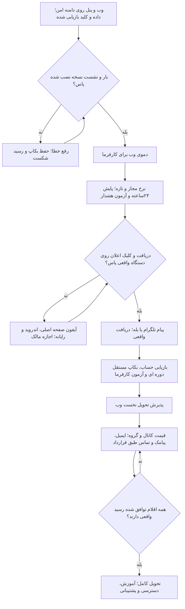
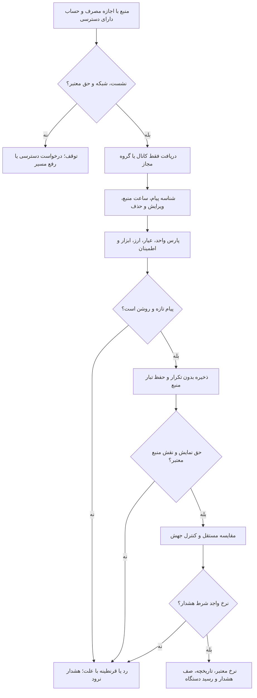

# نقشهٔ پایان نرخ‌بان — ۲۴ نوامبر ۲۰۲۶

اولویت مالک، تحویل اولیهٔ وب و وب‌اپ با اعلان است. [سایت](https://nerkhbaan.ir/) و [پنل مدیر](https://nerkhbaan.ir/admin/) روی VPS تازه قابل مشاهده‌اند؛ خرید سرور، جابه‌جایی DNS و گیت کش انتشار تازه بسته شده‌اند. [مرجع نصب، بار، منبع دقیق، اسکن و بکاپ](new-vps-coexist-2026-11-21-fa.md) وضع جاری را ثبت می‌کند؛ گزارش‌های تاریخ‌دار قبل، شاهد امروز نیستند.

## شاهد تازهٔ تحویل وب

[آزمون زندهٔ ۲۴ نوامبر](live-web-acceptance-2026-11-24-fa.md): ثبت‌نام، ورود با نام/ایمیل، نشست و خروج، جریان نرخ، CRUD هشدار و رسید واقعیِ درون سایت برای تتر و طلای مرجع پاس. API همان `303a301` و رابط نخستِ این دور `0a9e70f` بود؛ بریدگی قاب اعلان روی گوشی رفع و با ۱۸ چک روی منبع `141d912` نصب شد؛ ۳۱ بررسی واقعی پس از نصب پاس. API همان `303a301` ماند. پس از پاک‌سازی کامل کش دامنه توسط مالک، ۷۲ هش عمومی و بارگذاری نسخهٔ تازه با worker فعال هم پاس شد. دریافت پوشِ دستگاه هنوز باز است. دو پای مستقیم دلاری ناموجود، آزمون سبک سرعت با p95 حدود ۱٫۰۲ثانیه بالاتر از حد یک ثانیه، و توقف بکاپ دوره‌ای بر اثر سقف فضای محفوظ، اقلام بازِ تازه‌اند. رسیدِ درون سایت، دریافت روی iPhone نیست.

## چه چیز حاضر است؟

| بخش | شاهد | حد |
| --- | --- | --- |
| میزبان و دامنه | VPS نو، HTTPS، CDN، هدایت HTTP و تمدید آزمایشی پاس؛ کلید و داده حفظ شدند | ظرفیت طرح یک هسته/حدود۲گیگ محدود است؛ وقفهٔ کوتاه ارتقا پذیرفته شده |
| وب و حساب | گردش واقعی مرورگر ثبت‌نام، ورود ایمیلی، بازخوانی، خروج و لغو کوکی پاس | آزمون خود کارفرما هنوز ثبت نشده |
| مدیر | ورود با رمز دوم، کاربران، مرکز ارتباطات، بازخوانی و خروج واقعی پاس | خدمت پیامک و PBX هنوز وصل نیست |
| تاریخچهٔ حجیم | نمایهٔ جست‌وجو و جداسازی اتصال؛ نامزد تازه ابطال تراکنشی کش نمودار دارد | نتیجهٔ بار VPS و منبع نصب‌شده فقط از مرجع تازه خوانده شود |
| بکاپ | اصل همهٔ پروژه‌ها روی رایانه محفوظ؛ snapshot تازه، هش، انتقال رمز‌شده و بازیابی جدا آزموده شده | کپی‌های رایانه جای مقصد مستقل و برنامهٔ دوره‌ای نیستند |
| قیمت تلگرام | پارس، دریافت/ویرایش/حذف و حقوق منبع در کد و تست حاضرند | حساب خواننده و کانال/گروه مجاز نیست؛ جمع‌آوری زنده خاموش است |

دموی قابل مشاهده، تحویل کامل اعلان نیست. ایمیل هشدار، پیام تلگرام یا بله، پیامک و تماس از دامنهٔ توافق‌شده حذف نشده‌اند؛ هرکدام خدمت و رسید خود را می‌خواهند.

## دقیقاً تا تحویل نخست چه مانده؟

| ترتیب | کار | شرط پایان |
| --- | --- | --- |
| ۱ | پذیرش بار نسخهٔ نصب‌شده | ثبت‌نام، نشست و مدیر پاس شده‌اند. آزمون ترکیبی عمومی برای نرخ و نمودار از حد گذشت. اصلاح نمودار روی بکاپ بازیابی‌شده بررسی شد. بار عمومی، بکاپ هم‌زمان و شروع دوبارهٔ نسخهٔ نصب‌شده هنوز گیت باز هستند |
| ۲ | پوشش نرخ و پایش هشدار | رخداد واقعی تتر و طلای مرجع در سایت پاس؛ دو نرخ مستقیم دلاری غایب‌اند. پایش عمومی ۲۴ساعته شروع شد. قطع/وصل، جلوگیری از هشدار با دادهٔ کهنه و جلوگیری از تکرار، آزمون جدا می‌خواهند |
| ۳ | اعلان وب روی دستگاه | اتصال TLS سرور به مسیرهای Apple، FCM و Mozilla پاس شد. مالک هر سه دستگاه را دارد. رسید اعلان هنگام قفل یا پس‌زمینه و باز شدن صفحهٔ درست برای هر دستگاه لازم است |
| ۴ | پیام تلگرام یا بله | توکن ربات، مقصد متصل و رضایت؛ پیام واقعی، لغو اتصال و تکرارنشدن. مسیر تلگرام در کد هست؛ بله اگر انتخاب شود آداپتر و تست می‌خواهد |
| ۵ | بازیابی حساب و نگهداری | SMTP حاضر نیست؛ دریافت صندوق لازم. بکاپ دوره‌ای به سقف فضای محفوظ خورده و متوقف است؛ مقصد/ظرفیت جدا، کپی مستقل و آزمون بازیابی/هشدار شکست لازم |
| ۶ | آزمون و پذیرش خود کارفرما | حساب بسازد، نرخ/سن را بفهمد، هشدار را بسازد/ویرایش/خاموش کند، پیام بگیرد و خارج شود؛ ایرادها بسته و پذیرش ثبت شود |

راه شروع و برگهٔ پذیرش: [راهنمای کارفرما](customer-first-use-fa.md). پیامک، تماس، ایمیل هشدار و خواندن قیمت از تلگرام هم باید طبق دامنهٔ قرارداد تکمیل شوند؛ داشتن صفحهٔ تنظیم یا قبول درخواستِ سرویس، رسید تحویل نیست.

### اندازه‌گیری بار عمومی ۲۴ نوامبر

در بار ترکیبی روی دامنهٔ عمومی، هر مسیر ۴۰ درخواست داشت. هر ۱۲۰ پاسخ HTTP موفق بودند و میانگین نرخ ارسال حدود ۳٫۸ درخواست‌برثانیه بود.

| مسیر | p95 عمومی | حد پذیرش | نتیجه |
| --- | ---: | ---: | --- |
| نرخ جاری | ۱٫۳۴۱ ثانیه | ۱ ثانیه | باز |
| آمادگی API | ۰٫۶۴۴ ثانیه | ۱ ثانیه | پاس |
| نمودار یک‌سالهٔ بیت‌کوین | ۷٫۳۶۰ ثانیه | ۵ ثانیه | باز |

روی پایگاه بازیابی‌شده، مهاجرت ۱۶ و ابطال کش هنگام ویرایش تاریخچهٔ فشرده بررسی شدند. در یک اجرای پیش از اصلاح با `pg_dump` هم‌زمان، p95 نمودار ۶٫۸۳ ثانیه بود. نامزد `cfa561e` حق نرخ مستقیم را بدون پیمایش بازگشتی می‌سنجد و برای ارزیابی و ارسال مجدد هشدار یک‌بار نرخ جاری را می‌خواند. در بار محلی نامزد، همراه با ایجاد و بررسی یک dump، p95 نرخ جاری ۰٫۱۷ و نمودار ۱٫۹۹ ثانیه بود. برگشت به مهاجرت ۱۵ و شروع API قبلی هم روی کپی پاس شد. [رسید ساخت و اسکن بسته](https://github.com/Ilia-Shakeri/Nerkhbaan/actions/runs/45391190009).

روی سرور، ۲۵۱٬۲۷۷٬۳۱۲ بایت در آرشیو آزاد بود و سرویس دوره‌ای بکاپ برای شروع به ۲۶۸٬۴۳۵٬۴۵۶ بایت نیاز دارد. هر شش dump حفظ شده‌اند. کپی دستی روی رایانه با هش برابر و بازیابی آزمایشی حاضر است. نامزد تا آماده‌شدن مقصد دوره‌ای و اجرای آزمون بار بعد از نصب، پذیرش زنده ندارد.

برای ثبت تکرارشوندهٔ وضعیت عمومی آماده‌بودن، نرخ‌ها و زمان منابع، `scripts/monitor_public_rates.py --output <new-file.jsonl>` روی رایانهٔ روشن اجرا می‌شود. اجرای پیش‌فرض ۹۷ نمونه با فاصلهٔ ۱۵ دقیقه ثبت می‌کند. هر خط زمان و خطاهای نمونه را دارد.

## چه چیز تا تحویل کامل مانده؟

| کار باز | چه چیز حاضر است | چه چیز هنوز لازم است |
| --- | --- | --- |
| خواندن قیمت از کانال و گروه تلگرام | کد و تست دریافت/پارس/حق/تازگی | حساب خواننده، یک کانال و یک گروه مجاز، نمونهٔ پیام و حق مصرف؛ دریافت، ویرایش، حذف، قطع/وصل و «پیام تا هشدار» واقعی |
| هشدار در تلگرام یا بله | مسیر اتصال ربات تلگرام هست؛ مسیر بله در مرور قبلی یافت نشد | ربات و مقصد مجاز؛ دریافت واقعی تلگرام. اگر بله انتخاب شود، آداپتر و اتصال/صف/تست بله هم ساخته و سنجیده شود |
| ایمیل هشدار | مسیر نرم‌افزار هست | خدمت ارسال، فرستنده و تنظیم دامنه؛ رسید واقعی صندوق. بازیابی رمز نیز به ایمیلِ کارا نیاز دارد |
| پیامک | پنل و آداپتر کاوه‌نگار هست | حساب، کلید، خط فرستنده، اعتبار و شمارهٔ دارای رضایت؛ رسید واقعی پیامک |
| تماس در حالت خاص | پنل Asterisk ARI و سیاست تماس بحرانی هست | مرکز تماس، ARI، ترانک خروجی و مقصد مجاز؛ تماس طبق سیاست، پاسخ واقعی و ثبت نتیجه |
| تحویل و پشتیبانی | سند نسخه و راه بازیابی هست | انتقال دسترسی خصوصی، مسئول پایش، برنامه بکاپ، آموزش و بستن اقلام توافق‌شده با کارفرما |
| ویندوز، مسیر جدا | ساخت بسته هست؛ SignPath رایگان رد شده و حساب Store نیست | ناشر معتبر و تست نصب/ارتقا/حذف/اعلان. این مسیر، شرط تحویل وب نیست |

امضای ویندوز مسیر جداست؛ نبود ناشر نباید دموی وب را معطل کند. با این حال نبود دستگاه یا خدمت، با تست بدل پاس نام نمی‌گیرد. نرخ مرجع، نرخ مستقیم فیزیکی نیست و ساعت قیمت کهنه تغییر نمی‌کند.

## تلگرام: کد۲.۸.۱۹؛ پذیرش واقعی باز

| کد | کارِ حاضر | حدِ فعلی |
| --- | --- | --- |
| `apps/telegram_worker/app/worker.py` | فهرست مجاز از پایگاه، پیام تازه و ویرایش، جلوگیری از تکرار، ذخیرهٔ نرخ و نتیجهٔ پارس | گروه عادی و سوپرگروه در کد جدا پشتیبانی؛ حذف، بازیابی محدود و پیوند حساب افزوده شد؛ آزمون واقعی باز است |
| `apps/telegram_worker/app/parser.py` | پارس سخت، رقم فارسی/عربی، واحد، عیار، دامنه و اطمینان | قالب واقعی هر منبع باید با نمونهٔ مجاز سنجیده شود؛ یازده قالب صریح حاضر؛ متن دلخواه، عکس و صدا تضمین نیست |
| `apps/telegram_worker/app/source_rights.py` | حقِ تاریخ‌دار برای `telegram:<source_id>`؛ نبود حق یعنی نخواندن | حقِ کانال از عمومی‌بودن یا عضویت نتیجه نمی‌شود؛ مدرک و دامنهٔ مجاز لازم |
| `apps/api/app/admin/routers/providers.py` | ثبت/ویرایش منبع و پیش‌نمایش پارس با مجوز مدیر | ثبت منبع، به‌تنهایی نشست و اتصال زنده نمی‌سازد |
| `apps/api/app/pricing/telegram.py` | خواندن نرخ ذخیره‌شده با شرط تازگی، حق و نقش | مصرف قیمت فقط نقش `verifier` یا `fallback` می‌پذیرد؛ منبع اصلی خودکار نیست |
| `docker-compose.prod.yaml` | سرویس با پروفایل `telegram` | overlay اختیاری، فایل حق و پیوند حساب دارد؛ تصویر ثابت و اتصال واقعی هنوز پذیرش جدا خواهند |

### شرط قبولی تلگرام

1. یک کانال و یک گروه مورد تأیید مالک مشخص؛ شناسهٔ عددی درست، حق مصرف و حساب مجاز ثبت شود. گروه عادی، سوپرگروه و کانال با هم یکی شمرده نشوند.
2. پیام واقعی، ویرایش و تکرار با شناسه و ساعت درست ذخیره شوند. پیام مبهم، کهنه، آینده، واحد غلط، عیار نامعلوم و منبع ناشناس وارد هشدار نشوند.
3. برای حذف پیام، قطع/وصل، محدودیت درخواست، ابطال نشست، توقف خدمت و شروع دوباره سیاست و تست پایدار تکمیل شود. برای عقب‌مانده فقط تاریخچهٔ دارای اجازه جمع شود؛ هشدار قدیمی دوباره نرود.
4. سیاست مقایسه/جایگزین، اختلاف با منبع مستقل و لغو حق روی worker و API پاس شوند. نقش اصلی، صرف ثبت در پنل ایجاد نشود.
5. یک چرخهٔ واقعی «پیام → نرخ ذخیره → تاریخچه → هشدار → رسید» با شاهد بدون راز پاس شود. ۲۴ساعت پایش، سن منبع، تأخیر، قطع و نرخ ردها ثبت شود. پیام آزمون فقط در فضای تحت اختیار و با رضایت ارسال شود.
6. تصویر ثابت و اسکن، تست پایگاه واقعی، نگهبان طرح تک‌نمونه، تصویر دقیق و سرویس‌های محافظت‌شده پاس شوند. سپس کانال‌های بیشتر با همین دروازه افزوده شوند.

## دقیق از مالک چه لازم است؟

| بخش | داده یا کار لازم | راه امن |
| --- | --- | --- |
| میزبان و دامنه | مقصد و آروان حاضرند؛ برای این نصب، دسترسی تازه لازم نیست | کلید موجود حفظ شود؛ وضع تازه در مرجع نصب |
| دستگاه | iPhone اصلی کارفرما، Android و رایانه با رضایت اعلان | ورود و اجازه را مالک دستگاه بدهد؛ شاهد زمان دریافت و کلیک ثبت شود |
| قیمت تلگرام | `TELEGRAM_API_ID`، `TELEGRAM_API_HASH`، `TELEGRAM_SESSION_STRING`؛ حساب و منابع مجاز | `D:\Projects\Nerkhbaan\repo\.local-keys\telegram-ingestion.private.env`؛ کد ورود و نشست در گفتگو نیاید |
| منبع تلگرام | شناسهٔ دقیق کانال/گروه، ابزارها، قالب و اجازهٔ دریافت/ذخیره/نمایش/تاریخچه | [راهنمای اتصال](telegram-ingestion-guide-fa.md)؛ منبع خصوصی کانالیِ بی‌نام ممکن است `TELEGRAM_PEER_ACCESS_HASHES` همان حساب را هم بخواهد |
| پیام تلگرام | `TELEGRAM_BOT_TOKEN` و مقصد متصل به حساب | محیط خصوصی و تأیید خود کاربر؛ توکن ربات جای نشست خواندن قیمت نیست |
| ایمیل | `SMTP_HOST`، `SMTP_FROM`، پورت/TLS و در صورت نیاز `SMTP_USERNAME` و `SMTP_PASSWORD`؛ مقصد آزمون | `D:\Projects\Nerkhbaan\repo\.local-keys\notification-delivery.private.env`؛ رسید صندوق لازم |
| پیامک | کلید کاوه‌نگار، خط، اعتبار و شمارهٔ مجاز | در پنل مدیر؛ [راهنمای اتصال](admin-guide.md#راهنمای-اتصال-پیامک-و-تماس) |
| تماس | ARI `endpoint`، `username` و `password`، ترانک و مسیر تماس | در پنل مدیر؛ راهنما و تست پاسخ واقعی جدا |
| بکاپ مستقل | دیسک جدا یا مقصد خصوصی بیرون از این رایانه و سرور | کپی با هش برابر، برنامهٔ دوره‌ای و بازیابی آزمایشی |

کلیدهای VAPID و رمزگذاری موجود داخل بکاپ خصوصی حفظ شده‌اند. مالک هر سه دستگاه آزمون را دارد. ربات آزمون تلگرام، سرویس SMTP، منابع خواندن قیمت تلگرام و خدمات پیامک و تماس هنوز آماده نیستند.

## چک نهاییِ امضا توسط کارفرما

- [ ] دامنه، HTTPS و نسخهٔ دقیق روی میزبان پایدار ثبت شد.
- [ ] کاربر و مدیر با حساب جدا وارد و خارج شدند؛ نقش و نشست آزموده شد.
- [ ] نرخ معتبر، سن/واحد و نبود نرخ فهمیده شد؛ هشدار روی نرخ نامعتبر نرفت.
- [ ] ساخت، ویرایش، توقف، حذف و جلوگیری از پیام تکراری سنجیده شد.
- [ ] اعلان و کلیک واقعی روی دستگاه‌های توافق‌شده رسید دارد؛ iPhone در اولویت است.
- [ ] پیام تلگرام یا بله طبق خواستهٔ مرحلهٔ اول رسید دارد؛ تغییر دامنه فقط با توافق ثبت‌شده است.
- [ ] بازیابی رمز و بکاپ مستقل با تست واقعی پاس شد.
- [ ] راهنمای استفاده، دسترسی خصوصی و مسئول پشتیبانی تحویل شد.
- [ ] قابلیت‌های باز با نام روشن ثبت شد؛ اقلام لازمِ قرارداد هنوز باز نماند.

[راهنمای تحویل نخست](web-initial-delivery-fa.md) · [فهرست سندها](documentation-index-fa.md). رسید و CI هر نسخه، فقط همان منبع و زمان را پوشش می‌دهد؛ تست محلی، تصویر قدیم یا پاسخ۲۰۰، قبولی کامل پروژه نیست.
