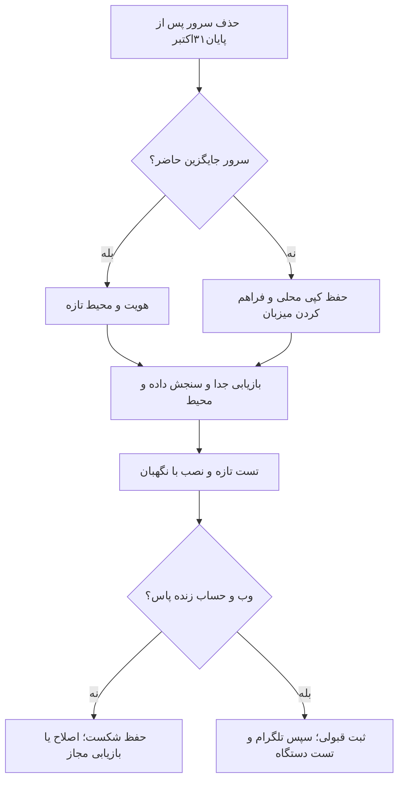

# بازیابی سرور و داده — ۲.۸.۱۹

مرور:۳۱اکتبر۲۰۲۶. سرور تا پایان امروز تمدید شده و سپس طبق گفتهٔ مالک حذف می‌شود. تصویر۲.۸.۱۹روی دو API سالم دیده شد؛ آزمون کامل حساب پاس نشد. [شاهد تازهٔ نجات](server-rescue-2026-10-31-fa.md) مرجع جاری است.

## بکاپ تازهٔ۳۱اکتبر

پوشهٔ اصلی: `D:\Projects\Nerkhbaan\delivery\private-backups\rescue-20261031`.
کپی دوم: `C:\Users\Dear-OTCamp-User\Documents\Nerkhbaan-Backups\20261031-final-all-projects`.

`production.dump` تازه،۱۱۸۶۴۳۶۰۵بایت، با SHA256 زیر است:
`923e0e54efe3571798a96b4a202dfce6126fb1dedeb747ca2e0caec5d9bbfc1b`.
بازیابی محلی۵۵جدول و۱۰مهاجرت پاس شد. تنظیم خصوصی در `configuration` و `runtime-and-config.private.json`، نقش‌ها در `database-roles.private.sql`، گواهی‌ها در `tls-certificates.private.tar`، صف در `redis-snapshot.private.tar` و تصاویر برنامه در `runtime` هستند. فایل‌های همهٔ پروژه‌ها در بستهٔ خصوصی جدا فهرست شده‌اند؛ راهنمای خود بسته و manifest آن خوانده شود. هیچ فایل خصوصی در Git نیست.

پیش از مصرف، `manifest.json` و هش فایل‌ها سنجیده شوند. بستهٔ آرشیو همهٔ تصویرها، شناسهٔ manifest و config جدا دارد؛ هر دو نوع را با هم اشتباه نگیرید. معماری تصویرهای فعلی Linux/amd64 است. تصویر backup به معنی پاس اسکن تازه یا نصب روی میزبان تازه نیست.

Redis، فایل‌ها و پایگاه ساعت‌های جدا دارند؛ صف قدیمی بی‌بررسی بازپخش نشود. کلید اعلان و رمزگذاریِ معتبر حفظ شود. دادهٔ پس از snapshot تضمین نشده. هر دو کپی روی یک رایانه‌اند؛ مقصد مستقل هنوز لازم است.

## snapshot قدیم۲۸اکتبر؛ سابقهٔ سالم و محفوظ

نسخهٔ کامل پایگاه، snapshot۲۸اکتبر۲۰۲۶، دو کپی دارد:

- `D:\Projects\Nerkhbaan\delivery\private-backups\urgent-20261028T073123931341Z\production.dump`
- `C:\Users\Dear-OTCamp-User\Documents\Nerkhbaan-Backups\20261028T073123931341Z\production.dump`

اندازهٔ هرکدام۱۱۶۸۵۱۳۱۸بایت؛ SHA256 هر دو در۳۱اکتبر دوباره برابر شد:
`119d3a965635912232bd84f7cd7aa140c94f7c44c237510bd131cc313ed17ccd`.

بازیابی جدا در۲۸اکتبر۰۷:۴۲UTC با۵۱جدول و۱۰مهاجرت پاس شد؛ در۳۱اکتبر فقط هش دوباره سنجیده شد، بازیابی دوباره انجام نشد. snapshot شامل۳۷۹۵۴۹نرخ canonical،۶۶۳۰۷۳نرخ provider،۲۶۶۶۲نرخ legacy و۹۰۵مرجع بود؛ آخرین رکورد بازار حدود۰۷:۲۶UTC۲۸اکتبر بود. دادهٔ بعد از snapshot تضمین نشده. هر دو کپی روی یک رایانه‌اند؛ مقصد مستقل هنوز لازم است. فایل `.partial` بکاپ معتبر نیست.

کنار کپی نخست، دو فایل خصوصی `configuration-root.private.env` و `configuration-active.private.env` حاضرند. مقدارها در Git و گفتگو نیایند. پیش از بازیابی، سازگاری و حضور کلیدهای لازم خصوصی سنجیده شود؛ کلید VAPID و کلید رمزگذاری خدمت‌ها، اگر معتبر و حاضرند، حفظ شوند. صرف وجود فایل، کامل‌بودن یا تازگی همهٔ کلیدها را ثابت نمی‌کند.

بستهٔ منبع و تصویر در `D:\Projects\Nerkhbaan\delivery\release-2.8.19-20261028` حاضر است. منبع ثابت `7978e8938d17c4749ba7c43044a5e3e22bcf0ad2` است؛ بستهٔ چهار تصویر، گراف و اسکنِ همان ساخت دارد. هش zip ساخت:
`33abe876019c2bed905830e413ae8961255dbcb976cfa497221c0b946bfef0c5`.
این فایل‌ها به‌تنهایی رسید نصب زنده نیستند.

## راه برگشت

1. مالک سرور جایگزین با نشانی، پورت SSH، کاربر و راه دسترسی خصوصی حاضر کند. رمز یا کلید در گفتگو نفرستد. خرید خدمت و تغییر پنل میزبان در این کار انجام نشده.
2. هویت میزبان و کلید میزبان، دیسک، حجم‌ها و خدمت‌های دیگر فقط‌خواندنی سنجیده شوند. هویت قدیم به سرور تازه تعمیم داده نشود؛ دادهٔ موجود پاک نشود.
3. اگر سرور قدیم برگشت، پیش از تکرار نصب۱۹، intent، فرایند و رسید اجرای قطع‌شده و تصاویر واقعی تعیین شوند. نبود رسید محلی، به معنی اجرا نشدن راه دور نیست.
4. برای سرور خالی، طرح زیرساخت و نقش‌های پایگاه، حجم‌های پایدار، Redis، شبکه و محیط خصوصی آماده شود. نگهبان فعلی نصب برنامه، ابزار ساخت زیرساخت خالی نیست. خط مبنای۲۲ظرف و۱۷خدمت قدیم، شاهد سرور تازه نیست.
5. ابتدا بکاپ روی پایگاه جدا و تحت اختیار بازیابی شود؛ نقش، مالکیت،۵۵جدول برای snapshot۳۱اکتبر،۱۰مهاجرت و نرخ‌های دارای زمان سنجیده شوند. نقش‌ها و دادهٔ مقصد با طرح روشن حفظ شوند. نسخهٔ اصلی dump دست‌نخورده بماند.
6. تنظیم دامنه، TLS، حق مصرف منابع، کلیدهای لازم و محیط خصوصی سنجیده شوند. تغییر DNS فقط پس از آماده و سالم بودن مقصد باشد؛ خاموشی collector تلگرام تا حساب و منابع مجاز حفظ شود.
7. تست تازهٔ تصویر ثابت، اسکن، محیط، مهاجرت، نرخ و اشغال واقعی صف پس‌زمینه پاس شود. با `scripts/deploy-nerkhbaan-prod.sh` و `deploy_application.py` نصب شود؛ هیچ دروازه دور زده نشود. شواهد۲۸اکتبر جای شاهد تازه ننشینند.
8. هر دو API، ثبت‌نام، ورود، بازخوانی نشست، خروج، رد نشست لغوشده و دارایی وب/پنل زنده سنجیده شوند. فقط پس از پاس، اشاره‌گر پذیرفته‌شده تغییر کند؛ شکست و نتیجهٔ نامعلوم حفظ شوند.
9. نسخهٔ مستقل بکاپ و آزمون بازیابی زمان‌بندی شود. دریافت واقعی تلگرام و اعلان روی دستگاه، قبولی‌های جدا هستند؛ با HTTP۲۰۰ بسته نشوند.

